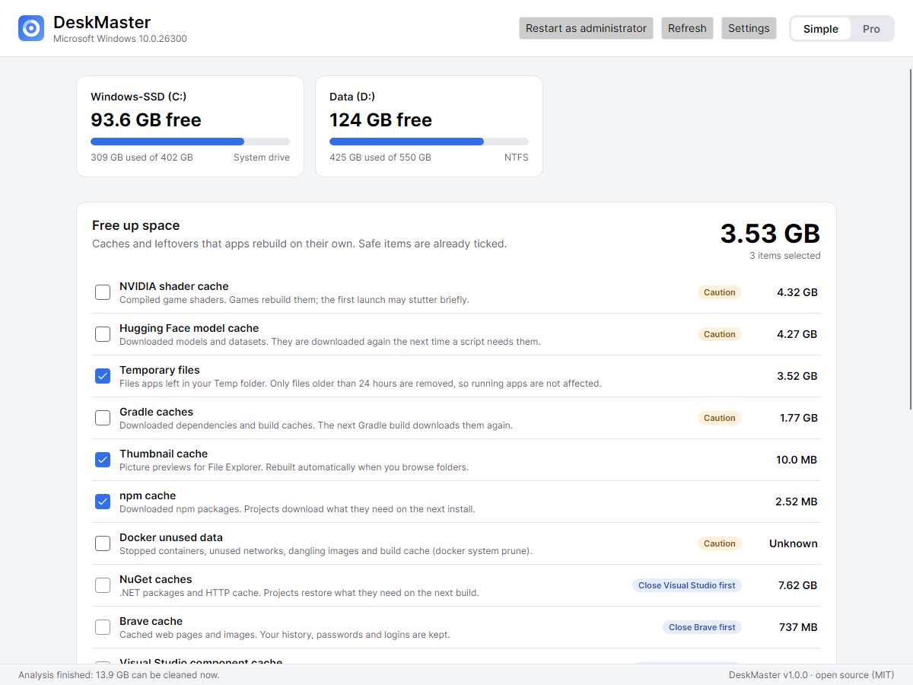
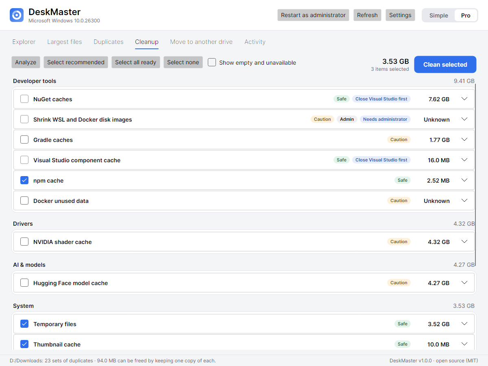
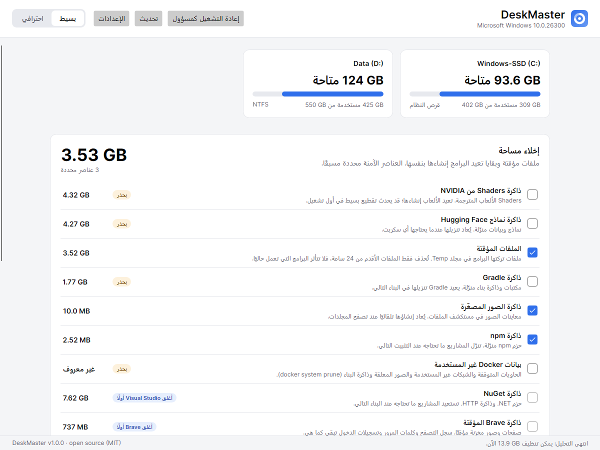
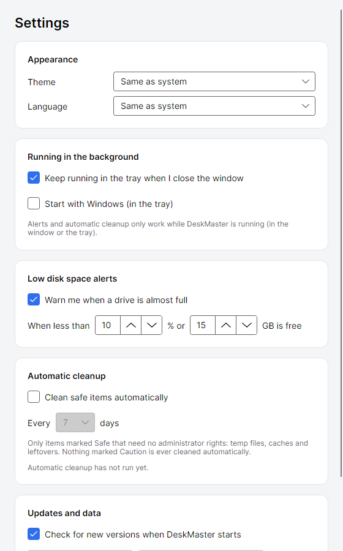

<p align="center">
  
</p>

<h1 align="center">DeskMaster</h1>

<p align="center">
  Find out what fills your disk, clean it safely and move big folders to another drive.<br/>
  Windows · macOS · Linux · desktop app + command line · English and العربية · free and open source (MIT).
</p>

<p align="center">
  <a href="https://github.com/mostafaelbagory/DeskMaster/releases/latest/download/DeskMaster-win-Setup.exe"></a>
  <a href="https://github.com/mostafaelbagory/DeskMaster/releases/latest/download/DeskMaster-osx-Setup.pkg"></a>
  <a href="https://github.com/mostafaelbagory/DeskMaster/releases/latest"></a>
</p>

<p align="center">
  <a href="https://github.com/mostafaelbagory/DeskMaster/releases/latest"></a>
  <a href="https://github.com/mostafaelbagory/DeskMaster/actions/workflows/ci.yml"></a>
  <a href="LICENSE"></a>
  <a href="CONTRIBUTING.md"></a>
</p>

<p align="center">
  
</p>

## Why

Disks fill up for reasons nobody sees: driver installers that pile up, AI models, package-manager
caches, browser caches, editor backups and Temp folders that never get emptied. DeskMaster finds
these places, tells you in plain language what each one is, and cleans only what is safe.

## Features

**Simple mode**, for everyone
- See every drive's free space at a glance, with a warning when it runs low.
- One list of things you can clean. Safe items are pre-ticked, and items with side effects are marked *Caution*.
- One click cleans them and shows how much space you got back. Long cleanups can be cancelled.
- Suggests big folders that can move to another drive, such as Ollama models and Downloads.

**Pro mode**, for power users and developers
- **Explorer**: a fast parallel scan of a drive or folder (the whole of a 400 GB system drive takes about 10–20 s), a sortable size list you can drill into, and a **treemap**. Right-click an item to move it to the Recycle Bin or delete it.
- **Largest files**: the 200 biggest files from the scan.
- **Duplicates**: finds files with identical content (size, quick hash, then full hash), keeps one copy and recycles the rest.
- **Cleanup**: every rule grouped by category, with the exact paths, commands, safety level and admin needs.
- **Move to another drive**: moves app folders (Ollama, Hugging Face, NuGet, Gradle, pip, LM Studio) and your Downloads. Every file is hash-checked before the original is removed, and an interrupted move can simply be started again.
- **Activity log** of everything that happened, kept between runs.

**Runs in the background (optional)**
- A tray icon warns you when a drive is almost full, and you set the threshold.
- Scheduled cleanup of safe items, for example every 7 days.
- Starts with Windows, at macOS login or with your Linux desktop session.

**Command line** for servers, SSH sessions and scripts:

```bash
deskmaster-cli drives
deskmaster-cli analyze
deskmaster-cli clean --dry-run
deskmaster-cli clean --yes
deskmaster-cli scan /var --top 30
deskmaster-cli duplicates ~/Pictures
deskmaster-cli movable
deskmaster-cli move ollama-models D:\
deskmaster-cli move-folder downloads D:\ --set-default
```

### What it cleans (48 rules)

| Category | Examples |
|---|---|
| System | Temp files (older than 24 h), stalled downloads (`.crdownload`), Windows Update downloads, crash dumps, thumbnail cache, Recycle Bin / Trash, DISM component cleanup, hibernation file, macOS logs and caches, Linux journal, APT/DNF caches |
| Drivers | NVIDIA app driver downloads (often 30+ GB!), NVIDIA/DirectX shader caches, AMD installer leftovers |
| Browsers | Chrome, Edge, Brave and Firefox caches. History, passwords and logins are kept. |
| Developer tools | npm, Yarn, pnpm, NuGet, pip, uv, Gradle, Maven, Cargo, Go, Docker, **WSL/Docker disk image shrinking**, Xcode, Visual Studio and JetBrains caches |
| Editors | VS Code and Cursor caches, and their multi-GB `state.vscdb.backup` files |
| Apps & AI | Teams, Spotify and Discord caches, the Hugging Face model cache |

Adding a rule only takes a few lines of JSON. See [docs/RULES.md](docs/RULES.md).

## Safety first

- **Nothing is deleted without your confirmation.** The analysis only reads.
- **Hard-coded guard rails:** drive roots, your home folder, Desktop, Documents, Downloads, Program Files, the Windows folder and system folders can never be cleaned, whatever a rule says. The explorer refuses to delete OS and program files.
- Symlinks and junctions are never followed. Files that are in use are skipped, never forced.
- Rules can require apps to be closed first, for example the browser for browser caches.
- The app runs without admin rights and asks for them only to unlock system items.
- Moves copy the folder, hash-check every file, and only then delete the original. Files are never overwritten: name clashes go into a `duplicates` folder.
- Automatic cleanup only touches rules marked *Safe* that need no admin rights.

<p align="center">
  
</p>

<p align="center">
  
  
</p>

## Download and install

| | Installer (recommended, updates itself) | Portable |
|---|---|---|
| **Windows 10/11** (64-bit) | [⬇ DeskMaster-win-Setup.exe](https://github.com/mostafaelbagory/DeskMaster/releases/latest/download/DeskMaster-win-Setup.exe) | [DeskMaster-win-Portable.zip](https://github.com/mostafaelbagory/DeskMaster/releases/latest/download/DeskMaster-win-Portable.zip) |
| **macOS** (Apple silicon) | [⬇ DeskMaster-osx-Setup.pkg](https://github.com/mostafaelbagory/DeskMaster/releases/latest/download/DeskMaster-osx-Setup.pkg) | [DeskMaster-osx-Portable.zip](https://github.com/mostafaelbagory/DeskMaster/releases/latest/download/DeskMaster-osx-Portable.zip) |
| **Linux** (x64) | `.AppImage` on the [latest release](https://github.com/mostafaelbagory/DeskMaster/releases/latest) | — |

All files: [latest release](https://github.com/mostafaelbagory/DeskMaster/releases/latest). You don't need to install .NET.

**Windows**
1. Download `DeskMaster-win-Setup.exe` and run it. It installs in a few seconds, without admin rights, and adds a Start-menu shortcut.
2. The installer isn't code-signed yet, so if Windows says *"Windows protected your PC"*, click **More info → Run anyway**.

**macOS**: open the `.pkg`. If macOS blocks it, right-click it, choose **Open**, then confirm.

**Linux**
```bash
chmod +x DeskMaster*.AppImage
./DeskMaster*.AppImage
```

**Command line**: `deskmaster-cli` is installed next to the app. On Windows it is in `%LOCALAPPDATA%\DeskMaster\current\`.

**Updates**: installed copies check for a new version when they start and update with one click. You can turn this off in Settings.

**Uninstall**: Windows *Settings → Apps → DeskMaster → Uninstall*; on macOS and Linux, delete the app. Your settings are in `%APPDATA%\DeskMaster` (Windows), `~/Library/Application Support/DeskMaster` (macOS) or `~/.config/DeskMaster` (Linux).

## Build from source

You need the [.NET 10 SDK](https://dotnet.microsoft.com/download).

```bash
git clone https://github.com/mostafaelbagory/DeskMaster.git
cd DeskMaster
dotnet test
dotnet run --project src/DeskMaster.App
dotnet run --project src/DeskMaster.Cli -- analyze
```

- `./build/publish.ps1` or `./build/publish.sh` builds portable single-file versions into `artifacts/`.
- [docs/RELEASING.md](docs/RELEASING.md) explains installers, auto-update and code signing.
- `dotnet run --project tools/Screenshots -- out D:\SomeFolder [en|ar]` renders the app without a screen and saves screenshots.

## Project layout

```
src/
  DeskMaster.Core/   scanning, cleanup rules, safety guard, moves, duplicates, background checks (no UI)
    Data/            cleanup-rules.json, relocations.json, translations-ar.json (community-editable)
  DeskMaster.App/    Avalonia desktop app: Simple + Pro modes, tray, light/dark, English/Arabic
  DeskMaster.Cli/    command-line tool built on the same core
tests/
  DeskMaster.Core.Tests/   engine tests (xUnit)
  DeskMaster.App.Tests/    headless UI tests and translation coverage
tools/Screenshots/   renders screenshots for the docs
docs/                RULES.md, RELEASING.md, screenshots
```

## Contributing

DeskMaster is built by the community, and **everyone is welcome**, from first-time contributors to experts:

- **Know an app that wastes disk space?** Add a cleanup rule: a few lines of JSON, no C# needed ([guide](docs/RULES.md)).
- **Speak another language?** Translate the app (English and Arabic so far).
- **Found a bug or have an idea?** [Open an issue](https://github.com/mostafaelbagory/DeskMaster/issues).
- **Developer?** Pick an issue, or improve the scanner, the UI or the tests.

Read [CONTRIBUTING.md](CONTRIBUTING.md), fork, and send a pull request.

## Roadmap

- More languages (the translation system is ready; add a dictionary)
- Windows ARM64 and Intel macOS installers
- Scheduled reports ("what grew this week")

## License

[MIT](LICENSE)
